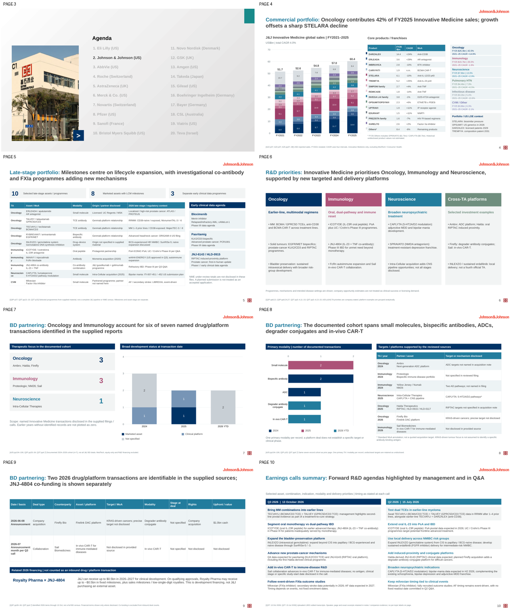
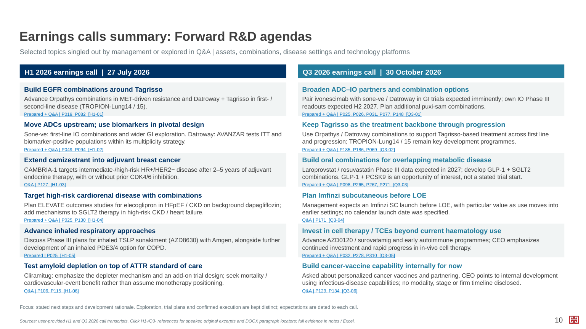
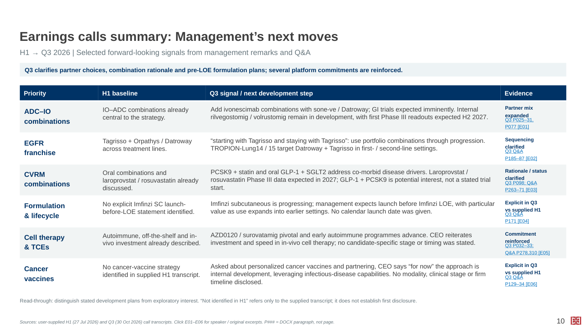
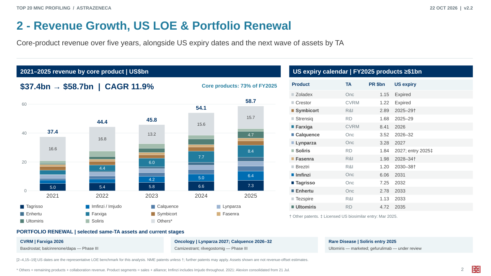

# Top 20 MNC Profiling

## J&J创新药M&A — 2021至今的已核实案例底稿（2026-11-05）

[下载Excel：6笔交易、11项资产/平台、历史阶段与机制字段](https://github.com/Yongxin-1/Top20-MNC/raw/refs/heads/main/deliverables/JNJ_Innovative_Medicine_MA_2021_2026_Verified_Cases_and_Gaps_20261105.xlsx) · [覆盖范围与缺口](deliverables/JNJ_Innovative_Medicine_MA_2021_2026_Verified_Cases_and_Gaps_20261105.md)

**非全量完成版。** 仅Innovative Medicine；已确认Ambrx、Proteologix、Yellow Jersey、Intra-Cellular、Halda、Firefly六笔交易。当前外部访问403，不能完成截至11月5日的全量公告检索；2021–23未识别不等于零交易，2026最晚已读来源为10月13日。收购时Phase不使用当前阶段倒填；未在所读附注确认的MoA/具体靶点等字段明确标注待一手核验。

## J&J — 3Q26官方管线：NME / LCM逐项核对

[下载Phase III与Registration分类Excel](https://github.com/Yongxin-1/Top20-MNC/raw/refs/heads/main/deliverables/JNJ_PhaseIII_Registration_NME_LCM_Reconciliation_3Q2026.xlsx)

依据用户上传的JNJ-Pipeline-3Q26.pdf（2026-10-13快照）逐卡片提取，93条阶段数与官方首页完全一致。40条Phase III项目中，10条属于5个独立药物NME（bleximenib、pasritamig、ramantamig、seltorexant、milvexian），1条为NBTXR3非药物放疗平台，29条为已有活性分子LCM。17条Registration项目包含icotrokinra初始新分子项目与16条LCM；ICOTYDE在H1/Q3 call已讨论上市，不能仅凭Registration标签将其算成当前未获批under-review NME。

Excel保留全部57条晚期项目原文、颜色阶段、分类理由和PDF页码，另列5项NME完整适应症/试验及机制补充说明。原PDF为selected/non-exhaustive清单，未据此声称公司全球under-review资产为零；MoA补充注释与PDF直接披露字段明确区分。本次未改PPT。

## Johnson & Johnson — P4按TA排序Excel修订版（2026-11-04）

[下载P4产品销售、MoA与TA文字块Excel](https://github.com/Yongxin-1/Top20-MNC/raw/refs/heads/main/deliverables/JNJ_P4_TA_Sorted_Product_Sales_and_TA_Blocks_20261104_v2.xlsx)

严格筛选FY2025销售>USD1bn的15个产品/披露家族。按完整TA的FY2025销售升序排列，同TA内按产品销售升序排列，最大TA和产品在下方。附FY2021–25及FY2026H1数据、MoA、来源页码，以及FY2025/FY2026H1右侧TA文字块。SPRAVATO的FY2021收入在上传材料中未单列披露，保留空白；不并入Others。

本次未修改PPT。下方J&J初版P4的分组及P5的LCM项目展示不符合用户范围，不能作为本次口径。P5仅限Phase III NMEs、under-review NMEs和2026年首次获批NMEs；本Excel附范围核对，不声称已有完整NME清单。JNJ-4804的co-antibody指guselkumab与golimumab两个单抗联合，不是单分子双抗。

## Johnson & Johnson — 2026-11-04，P3–P10初版

[下载更新后的19页主PPT](https://github.com/Yongxin-1/Top20-MNC/raw/refs/heads/main/deliverables/Top20_MNC_Portfolio_and_Pipeline_Strategy_Intelligence_JNJ_20261104_v1.pptx)

[查看J&J八页PDF](deliverables/JNJ_Section_P3-P10_20261104_v1.pdf) · [下载数据与证据Excel](https://github.com/Yongxin-1/Top20-MNC/raw/refs/heads/main/deliverables/JNJ_Profile_Data_and_Evidence_20261104.xlsx) · [方法与覆盖限制](deliverables/JNJ_Section_Methodology_中文.md)

J&J P3–P10已替换，AZ P11–P18及其他页面保留。新增3个原生可编辑图表，J&J段含5个原生表格。财务聚焦InnovativeMedicine，五年逐产品核平。

**晚期管线为10项可核实的选定项目；BD为7笔具名2024–26交易，不是全量NME或全量BD census。**上传材料未提供完整清单，缺失不计为零；详细定义见底稿。

## AZ Earnings-call summary — v5：Q3左／H1右，正文简洁版

第10页Q3在左、H1在右；保留药物MoA，去除每个话题下方Prepared/Q&A与段落号标注。来源留在页脚、备注和既有证据底稿；其余页面不变。

[下载最新版PPT](https://github.com/Yongxin-1/Top20-MNC/raw/refs/heads/main/deliverables/Top20_MNC_Strategy_Intelligence_AZ_Call_Agendas_20261104_v5_Clean.pptx) · [查看单页PDF](deliverables/AZ_Call_Agendas_v5_Clean_OnePage.pdf)

## AZ Earnings-call summary — v3：药物括号标注MoA

在独立H1/Q3总结页中，为16个提及的药物添加简短MoA/target-modality说明；保留原文证据和12条引用链接，其余10页不变。Excel新增MoA词表。

[下载最新版PPT（含MoA）](https://github.com/Yongxin-1/Top20-MNC/raw/refs/heads/main/deliverables/Top20_MNC_Strategy_Intelligence_AZ_Call_Agendas_20261104_v3_MoA.pptx)

[查看单页PDF](deliverables/AZ_Call_Agendas_v3_MoA_OnePage.pdf) · [下载证据底稿与MoA词表](https://github.com/Yongxin-1/Top20-MNC/raw/refs/heads/main/deliverables/AZ_Call_Agendas_Evidence_v3_MoA.xlsx)

## AZ Earnings-call summary — 分别总结每次call的前瞻R&D议题（v2）

H1和Q3各6条主议题，独立总结管理层专门强调或Q&A深入讨论的未来开发方向，服务内部R&Dstrategy跟踪。正文不再按两次call对比或变化分类；底稿另列议题被讨论的原因、具体下一步、分析者R&D关注维度及证据边界。其余10页保持不变。

[下载更新后的PPT v2](https://github.com/Yongxin-1/Top20-MNC/raw/refs/heads/main/deliverables/Top20_MNC_Strategy_Intelligence_AZ_Call_Agendas_20261104_v2.pptx)

[查看单页PDF](deliverables/AZ_Call_Agendas_v2_OnePage.pdf) · [下载逐议题证据Excel](https://github.com/Yongxin-1/Top20-MNC/raw/refs/heads/main/deliverables/AZ_H1_Q3_2026_Call_Agendas_Evidence_v2.xlsx) · [查看原文与R&D关注维度](deliverables/AZ_H1_Q3_2026_Call_Agendas_Evidence_v2.md)

## 历史：H1 → Q3 transcript 对比版（已由上方独立call总结替代）

已读取用户提供的H1与Q3两份transcript，覆盖预备发言和Q&A，并更新主文件第10页；其余10页保持原样。主页面6条信号，底稿12个主题、43条可定位原文。原始DOCX未上传仓库。此版替代此前仅依据presentation的工作草稿。

[下载更新后的主PPT](https://github.com/Yongxin-1/Top20-MNC/raw/refs/heads/main/deliverables/Top20_MNC_Strategy_Intelligence_AZ_Earnings_Call_Summary_20261104.pptx)

[查看单页PDF](deliverables/AZ_Earnings_Call_Summary_20261104_OnePage.pdf) · [下载原文与比较底稿Excel](https://github.com/Yongxin-1/Top20-MNC/raw/refs/heads/main/deliverables/AZ_H1_Q3_2026_Transcript_Evidence_20261104.xlsx) · [查看可搜索原文片段与来源定位](deliverables/AZ_H1_Q3_2026_Transcript_Evidence_20261104.md)

P###表示原始DOCX正文段落号（含空段落），不是页码。未在H1识别到某提法不等于公司首次披露；潜在组合兴趣不等于已启动试验。IR公共链接仅作导航，本次证据为用户上传文稿。

## 历史：管理层前瞻工作草稿（已由上方transcript版替代）

已填写用户上传主文件第10页，其余10页保持不变。**该历史草稿当时未读取transcript/Q&A，证据仅为2026-07-27及以前的官方业绩材料；现已由上方transcript版替代。**网络代理403阻止最新IR来源读取，页面保留醒目草稿标识。请勿将其当作已完成的最新电话会总结。

[下载主PPT（第10页已填写）](https://github.com/Yongxin-1/Top20-MNC/raw/refs/heads/main/deliverables/Top20_MNC_Strategy_Intelligence_AZ_Management_Outlook_DRAFT_20261104.pptx)

[查看单页PDF](deliverables/AZ_Management_Outlook_DRAFT_OnePage_20261104.pdf) · [下载逐条证据Excel](https://github.com/Yongxin-1/Top20-MNC/raw/refs/heads/main/deliverables/AZ_Management_Outlook_Evidence_DRAFT_20261104.xlsx) · [来源与完成范围](deliverables/AZ_Management_Outlook_DRAFT_Methodology_中文.md)

## AstraZeneca — v2.2

[下载可编辑 PPTX v2.2](https://github.com/Yongxin-1/Top20-MNC/raw/refs/heads/main/deliverables/AstraZeneca_MNC_Profile_v2.2.pptx)

[下载底层数据与来源 Excel v2.2](https://github.com/Yongxin-1/Top20-MNC/raw/refs/heads/main/deliverables/AstraZeneca_Profile_Data_and_Sources_v2.2.xlsx)

[查看 PDF v2.2](deliverables/AstraZeneca_MNC_Profile_v2.2.pdf)

[本次修改与数据口径](deliverables/v2.2_Layout_and_Data_中文.md)

### 管线计数澄清（2026-10-23）

旧PPT第3页的45条网页项目、21个公司披露late-stage NMEs、4个under-review新资产是不同口径，不可直接加总。新增资产级对账：按新活性资产去重、已获批资产另列、取最高阶段，重建为17个Phase III +4个under review。此为分析重建，尚非公司明示的headline21逐项名单；本次未改动PPT。

[下载21项资产与45条原始项目逐行对账Excel](https://github.com/Yongxin-1/Top20-MNC/raw/refs/heads/main/deliverables/AstraZeneca_LateStage_NME_Count_Reconciliation_2026Q2.xlsx)

[查看口径、完整名单与来源](deliverables/AstraZeneca_LateStage_NME_Count_Reconciliation_中文.md)

### 医药魔方名称核对（2026-10-23）

34条输入与AZ官网/临床附录对照：确认13个独立核心资产；2个中文候选别名待确认；6个核心资产尚无明确对应。AZD6234为Phase II。未把历史Phase III-ready等同正在开展Phase III；未核实中文身份的项目保留待定。

[下载34条名称、21项覆盖、modality与target对照Excel](https://github.com/Yongxin-1/Top20-MNC/raw/refs/heads/main/deliverables/AstraZeneca_Pharmcube_Name_Crosswalk_and_Targets_2026Q2.xlsx)

[查看核对表与证据说明](deliverables/AstraZeneca_Pharmcube_Name_Crosswalk_中文.md)

### 17项Phase III完整适应症（2026-10-23）

逐资产整理适应症、完整试验人群、联合方案及官方来源页码。补充rilvegostomig在已上市产品LCM表中的尿路上皮癌、子宫内膜癌等组合项目；Phase I/III与Phase II/III另列，标记Initiating项目。沿用2026-07-27快照，不声称全球注册库全量覆盖。

[下载17项资产完整适应症Excel](https://github.com/Yongxin-1/Top20-MNC/raw/refs/heads/main/deliverables/AstraZeneca_17_PhaseIII_Full_Indications_2026Q2.xlsx)

[查看适应症概览与展示建议](deliverables/AstraZeneca_17_PhaseIII_Indications_中文.md)

### 本版内容

1. Executive Summary：事实摘要。
2. Revenue Growth, US LOE & Portfolio Renewal：2021–2025按核心产品拆分的堆叠柱图、CAGR；15个主要产品的US专利日期、TA与收入；同TA后续资产。
3. Phase III & Registration-stage Pipeline：按TA和靶点归纳；Excel保留完整官网项目记录。
4. Company-disclosed R&D Priorities：公司披露的四类投资方向及项目。
5. BD 2022–2026 YTD：30笔有官方来源的交易，按类型、TA、modality与靶点整理。

### 如何下载

1. 登录有权访问仓库的 GitHub 账号。
2. 点击上方“下载可编辑 PPTX v2.2”；或打开 `deliverables` 文件夹中的同名文件。
3. 在文件页面点击 **Download raw file**（向下箭头）保存。无法在线预览不影响下载。
4. 也可以在仓库主页点击 **Code → Download ZIP**，解压后在 `deliverables` 找到文件。

### 数据口径

- 财务为2021–2025五个完整年度；报告美元CAGR使用四个增长区间，包括并购、范围及汇率影响。2021年Alexion自7月21日起并表。
- 按分析设定，US到期日期用作代表性LOE时间尺度。专利日期不一定是实际仿制进入日；已知Soliris US生物类似药进入时间另列。
- 产品堆叠为销售加联盟收入；Others包括其余产品及合作收入。Imfinzi与Imjudo合并以保持五年可比。
- 管线及研发框架为2026-07-27快照。“Under review”指一个或多个主要市场。
- BD截至2026-10-21。30笔为有来源的记录集，并非所有AZ交易的全量统计。2026YTD与全年分开阅读。
- 来源链接与定义见每页备注和Excel。

### 历史版本

- [v2.1 格式修复说明](deliverables/v2.1_Compatibility_Repair.md)
- [v2.1 PPTX](deliverables/AstraZeneca_MNC_Profile_v2.1.pptx)
- [v2.0 内容调整说明](deliverables/v2_Changes_and_Methodology_中文.md)
- [v1.0 PPTX](deliverables/AstraZeneca_MNC_Profile_v1.0.pptx)
