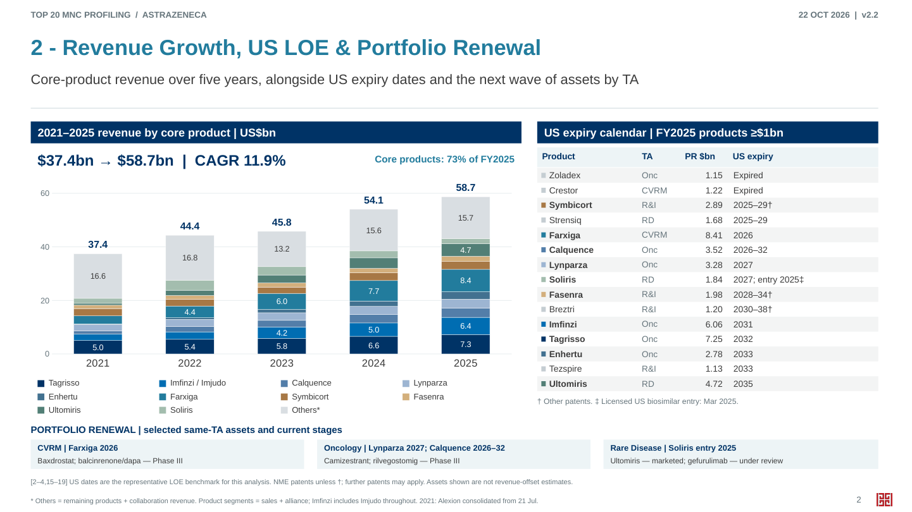

# Top 20 MNC Profiling

## AstraZeneca — v2.2

[下载可编辑 PPTX v2.2](https://github.com/Yongxin-1/Top20-MNC/raw/refs/heads/main/deliverables/AstraZeneca_MNC_Profile_v2.2.pptx)

[下载底层数据与来源 Excel v2.2](https://github.com/Yongxin-1/Top20-MNC/raw/refs/heads/main/deliverables/AstraZeneca_Profile_Data_and_Sources_v2.2.xlsx)

[查看 PDF v2.2](deliverables/AstraZeneca_MNC_Profile_v2.2.pdf)

[本次修改与数据口径](deliverables/v2.2_Layout_and_Data_中文.md)

### 管线计数澄清（2026-10-23）

旧PPT第3页的45条网页项目、21个公司披露late-stage NMEs、4个under-review新资产是不同口径，不可直接加总。新增资产级对账：按新活性资产去重、已获批资产另列、取最高阶段，重建为17个Phase III +4个under review。此为分析重建，尚非公司明示的headline21逐项名单；本次未改动PPT。

[下载21项资产与45条原始项目逐行对账Excel](https://github.com/Yongxin-1/Top20-MNC/raw/refs/heads/main/deliverables/AstraZeneca_LateStage_NME_Count_Reconciliation_2026Q2.xlsx)

[查看口径、完整名单与来源](deliverables/AstraZeneca_LateStage_NME_Count_Reconciliation_中文.md)

### 医药魔方名称核对（2026-10-23）

34条输入与AZ官网/临床附录对照：确认13个独立核心资产；2个中文候选别名待确认；6个核心资产尚无明确对应。AZD6234为Phase II。未把历史Phase III-ready等同正在开展Phase III；未核实中文身份的项目保留待定。

[下载34条名称、21项覆盖、modality与target对照Excel](https://github.com/Yongxin-1/Top20-MNC/raw/refs/heads/main/deliverables/AstraZeneca_Pharmcube_Name_Crosswalk_and_Targets_2026Q2.xlsx)

[查看核对表与证据说明](deliverables/AstraZeneca_Pharmcube_Name_Crosswalk_中文.md)

### 本版内容

1. Executive Summary：事实摘要。
2. Revenue Growth, US LOE & Portfolio Renewal：2021–2025按核心产品拆分的堆叠柱图、CAGR；15个主要产品的US专利日期、TA与收入；同TA后续资产。
3. Phase III & Registration-stage Pipeline：按TA和靶点归纳；Excel保留完整官网项目记录。
4. Company-disclosed R&D Priorities：公司披露的四类投资方向及项目。
5. BD 2022–2026 YTD：30笔有官方来源的交易，按类型、TA、modality与靶点整理。

### 如何下载

1. 登录有权访问仓库的 GitHub 账号。
2. 点击上方“下载可编辑 PPTX v2.2”；或打开 `deliverables` 文件夹中的同名文件。
3. 在文件页面点击 **Download raw file**（向下箭头）保存。无法在线预览不影响下载。
4. 也可以在仓库主页点击 **Code → Download ZIP**，解压后在 `deliverables` 找到文件。

### 数据口径

- 财务为2021–2025五个完整年度；报告美元CAGR使用四个增长区间，包括并购、范围及汇率影响。2021年Alexion自7月21日起并表。
- 按分析设定，US到期日期用作代表性LOE时间尺度。专利日期不一定是实际仿制进入日；已知Soliris US生物类似药进入时间另列。
- 产品堆叠为销售加联盟收入；Others包括其余产品及合作收入。Imfinzi与Imjudo合并以保持五年可比。
- 管线及研发框架为2026-07-27快照。“Under review”指一个或多个主要市场。
- BD截至2026-10-21。30笔为有来源的记录集，并非所有AZ交易的全量统计。2026YTD与全年分开阅读。
- 来源链接与定义见每页备注和Excel。

### 历史版本

- [v2.1 格式修复说明](deliverables/v2.1_Compatibility_Repair.md)
- [v2.1 PPTX](deliverables/AstraZeneca_MNC_Profile_v2.1.pptx)
- [v2.0 内容调整说明](deliverables/v2_Changes_and_Methodology_中文.md)
- [v1.0 PPTX](deliverables/AstraZeneca_MNC_Profile_v1.0.pptx)
